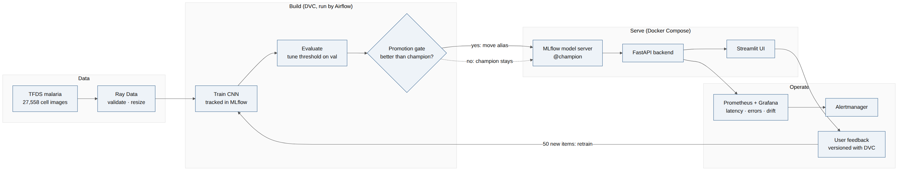
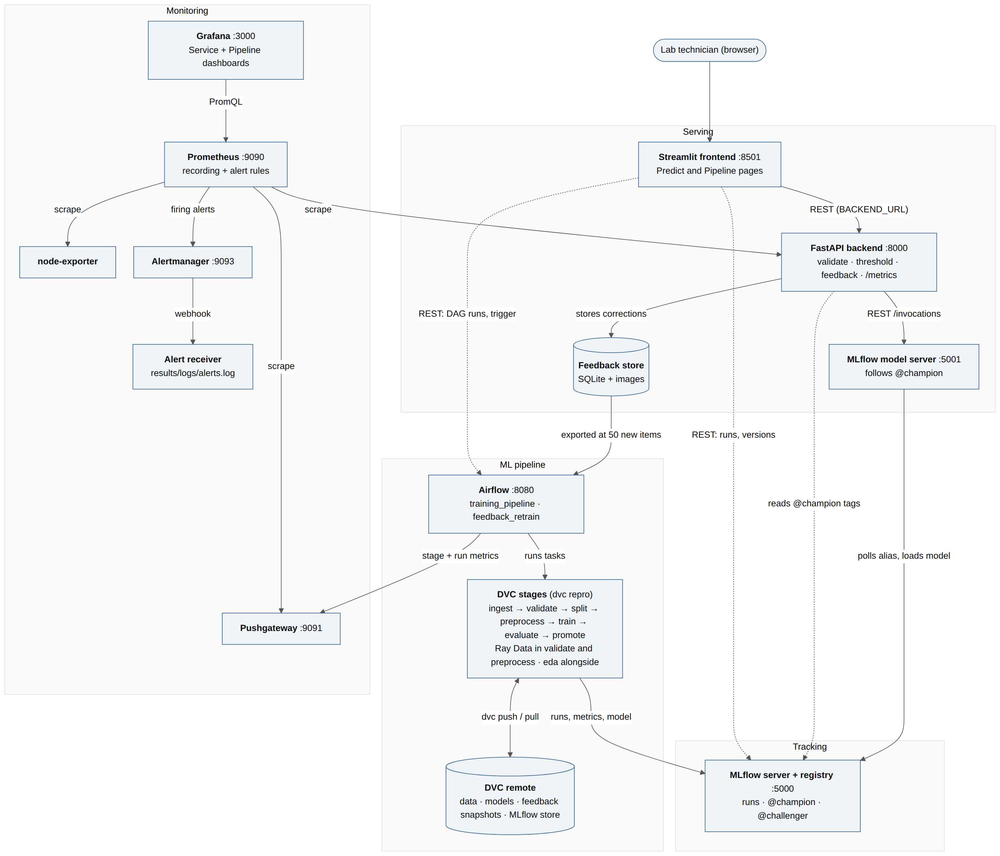

# High-Level Design: MalariaScope

## 1. Purpose

MalariaScope sorts single-cell images from Giemsa-stained thin blood smears into **Parasitized** or **Uninfected**. It is a fast, consistent screening aid for laboratory technicians, who upload a cell image, read the result with a confidence score, and can confirm or correct it. It supports a trained reader and doesn't replace one.

Around the model sits a full ML lifecycle: versioned data, reproducible pipeline stages, tracked experiments, gated promotion, containerised serving, monitoring with alerts, and retraining from user feedback. Everything runs on one machine, with no cloud services, as the course requires.

## 2. Architecture overview

### 2.1 High-level design

Data is prepared and versioned, the pipeline trains and gates a model, the champion is served, and monitoring and user feedback feed the next training run.

### 2.2 Architecture

The system has four parts. Each block is explained in [architecture.md](architecture.md).

- **Serving:** Streamlit calls FastAPI, FastAPI calls the MLflow model server. Corrections go to the feedback store.
- **Tracking:** the MLflow server holds runs, artifacts and the model registry. The `@champion` alias decides what is served.
- **ML pipeline:** Airflow runs the DVC stages. DVC versions the data and models in a local remote.
- **Monitoring:** Prometheus scrapes the backend, the host and the Pushgateway. Grafana shows the dashboards, and Alertmanager routes alerts to a log.

### 2.3 Design paradigm

Pipeline stages are **functional**: each is a script that reads declared inputs and writes declared outputs, which is what lets DVC cache and skip them. The services are **object-oriented**: `ModelClient` and `FeedbackStore` wrap the model server and the store behind small interfaces, and the FastAPI app comes from a `create_app()` factory so tests can inject a fake model.

## 3. Key components and responsibilities

| Component | Technology | Responsibility |
|---|---|---|
| UI | Streamlit 1.65 | Predict page (upload, result, feedback) and Pipeline page (runs, models, links to tools) |
| API | FastAPI 0.162 | Validates uploads, calls the model, applies the tuned threshold, stores feedback, exposes metrics |
| Model serving | `mlflow models serve` | Serves the `@champion` version over REST and follows the alias |
| Model | Keras 3 CNN on TensorFlow 2.21 | 3 convolutional blocks on 64×64 RGB input, 2-way softmax |
| Data engineering | Ray Data 2.59 | Parallel image validation and resizing |
| Pipeline / CI | DVC 3.67 | 8 stages with hashed inputs and outputs, data and model versioning, experiments |
| Orchestration | Airflow 2.10 | `training_pipeline` and the 30-minute `feedback_retrain` DAG |
| Tracking and registry | MLflow 3.17 | Runs, metrics, artifacts, model versions, aliases |
| Monitoring | Prometheus, Pushgateway, Alertmanager, node-exporter, Grafana | Metrics from service, host and pipeline; 10 alert rules; 2 dashboards |
| Packaging | Docker Compose, MLproject | 12 pinned services with healthchecks; one entry point per stage |

## 4. Data flow

### 4.1 Inference

1. The user uploads a PNG or JPEG (at most 5 MB) or picks a sample, then clicks **Analyse**.
2. Streamlit posts the file to the backend at `BACKEND_URL`.
3. The backend validates the file and resizes it with `to_model_input()`, the same function the pipeline uses, so serving can't drift from training.
4. The backend posts the pixels to the model server's `/invocations` and gets `p(parasitized)`.
5. The backend applies the champion's tuned threshold and updates its Prometheus metrics, including mean image intensity for drift.
6. The UI shows the label, the confidence and a low-confidence warning below 70%.
7. The user can confirm or correct the result. The image and the label go to the feedback store.

Measured over 50 calls through the containers: p50 59.2 ms, p95 247.0 ms.

### 4.2 Training pipeline

`ingest → validate → split → preprocess → train → evaluate → promote`, with `eda` alongside.

| Stage | What it does | Result on 27,558 images |
|---|---|---|
| ingest | TFDS to PNG files plus a manifest | 13,779 per class |
| validate | Ray checks for unreadable, non-RGB, wrong-size and blank images; removes duplicates | None dropped |
| split | Seeded stratified 80/10/10 | 22,046 / 2,756 / 2,756 |
| preprocess | Ray resize to 64×64 uint8 `.npz` | About 5,000 images/s |
| train | Keras CNN with early stopping, logged to MLflow | About 7 minutes on CPU |
| evaluate | Picks the threshold on val for 97% recall, applies it to test | Test metrics and plots |
| promote | Registers a challenger and compares it with the champion on the same test split | Moves the alias, or doesn't |

### 4.3 Feedback and retraining loop

1. Every 30 minutes `feedback_retrain` asks the backend how many feedback items are new.
2. With 50 or more, it exports them to `data/feedback`, versions the snapshot with `dvc add`, and starts `training_pipeline`.
3. The split stage adds feedback to the **train split only**. Val and test stay fixed, so challenger and champion are compared on identical images.
4. A leakage guard drops feedback whose pixels match a val or test image.
5. The promotion gate decides. If the alias moves, the model server switches by itself within about 20 seconds.

This ran for real on 4 Nov: 60 feedback items were added to training, and the gate rejected v2 (accuracy 0.9561 vs 0.9626), so v1 kept serving.

## 5. Design choices and reasons

The facts under each choice come from the project's logs. *Your reasoning* is left for you to write in your own words, since the viva tests whether you can defend these.

### 5.1 Loose coupling of UI and backend through configurable REST

- **Chosen:** the UI reaches the backend only through `BACKEND_URL`; the backend reaches the model only through `MODEL_SERVER_URL`.
- **Alternative:** a single app, or a hard-coded address (the reference repo hard-codes `http://backend:8000/predict`).
- **Evidence:** the rubric requires strict loose coupling. UI-02 and UI-09 show the UI stays up with every service down.

*Your reasoning:*

### 5.2 Ray rather than Spark for preprocessing

- **Chosen:** Ray Data `map_batches` in the validate and preprocess stages.
- **Alternative:** PySpark.
- **Evidence:** Assignment 3 used the same Ray Data style. With 32 blocks across 16 cores, validate went from 15.4 s to 5.1 s and preprocess from 14.1 s to 5.4 s, with byte-identical output.

*Your reasoning (image files, per-file Python work, laptop CPU):*

### 5.3 DVC stages run by Airflow, rather than logic duplicated in both

- **Chosen:** each Airflow task is `dvc repro <stage>`.
- **Alternative:** implement the steps as Airflow tasks and keep a separate DVC pipeline.
- **Evidence:** a run with no new data finishes in under a minute because DVC skips each stage (2–6 s per task).

*Your reasoning:*

### 5.4 Keras CNN at 64×64

- **Chosen:** a small CNN, lr 1e-3, filters [32, 64, 128], with augmentation.
- **Alternatives tested:** 5 DVC experiments on the fixed test split.

| Experiment | Train time | Accuracy at 0.5 | Threshold | Tuned accuracy | Recall | Missed cells |
|---|---|---|---|---|---|---|
| **baseline (chosen)** | 420 s | 0.965 | 0.242 | 0.963 | 0.967 | 45 |
| lr5e-4 | 782 s | 0.966 | 0.380 | 0.963 | 0.967 | 46 |
| wider | 369 s | 0.962 | 0.119 | 0.956 | 0.971 | 40 |
| img96 | 856 s | 0.963 | 0.190 | 0.959 | 0.971 | 40 |
| no-augment | 295 s | 0.957 | 0.124 | 0.957 | 0.972 | 39 |

*Your reasoning (CPU only, cell image size, accuracy target):*

### 5.5 Backend calls the MLflow model server rather than loading the model

- **Chosen:** REST to `/invocations`.
- **Alternative:** load the model inside FastAPI, as the reference repo does.
- **Evidence:** backend image 560 MB, model server image 3.03 GB (TensorFlow). A promotion restarts only the model server. The cost is one extra hop, and a brief window after a promotion when the backend's cached threshold and the served model can differ (at most `MODEL_INFO_TTL`, 60 s).

*Your reasoning:*

### 5.6 Feedback storage format

- **Chosen:** image files under `images/<label>/` plus SQLite metadata; a snapshot of new items goes to DVC.
- **Alternative:** SQLite blobs (reference repo), or a CSV index.
- **Evidence:** the snapshot matches on a pixel hash, so a match survives re-encoding. This caught the 2 UI samples taken from the test set (`leaked_dropped 2`).

*Your reasoning:*

### 5.7 Promotion rule and rollback

- **Chosen:** register as `@challenger`, score challenger and champion on the same test split, promote only if recall ≥ 0.95 and accuracy gain ≥ 0.005 (about 14 images). The old champion becomes `@previous_champion`, and `rollback.py` swaps them back.
- **Alternative:** promote on any gain, or on recall alone.
- **Evidence:** the gate rejected v2 despite slightly higher recall (0.9695 vs 0.9673), because it raised false alarms from 58 to 79.

*Your reasoning:*

### 5.8 SQLite and file storage rather than a database server

- **Chosen:** SQLite for feedback, MLflow and Airflow (the reference repo's pattern, with Airflow's `SequentialExecutor`).
- **Alternative:** a Postgres service.
- **Evidence:** one machine and one writer per database. The cost is that Airflow runs one task at a time, which is why `feedback_retrain` starts training without waiting for it.

*Your reasoning:*

### 5.9 Threshold tuned for recall

- **Chosen:** the highest threshold on p(parasitized) whose **val** recall is at least 0.97, stored as a tag on the model version.
- **Alternative:** keep 0.5, or tune on test.
- **Evidence:** on the test split, champion v1 misses 69 infected cells at 0.5 (recall 0.950, 28 false alarms). At 0.2417 it misses 45 (recall 0.967, 58 false alarms). Tuning on test would leak.

*Your reasoning:*

## 6. Non-functional requirements

| Requirement | How it is met | Status |
|---|---|---|
| Reproducibility | Every MLflow run carries the Git commit, DVC data hash and a `git_dirty` flag. Same commit and data gave identical metrics | Met |
| Portability | Pinned images, `environment.yml`, `MLproject`, Compose. A fresh clone comes up with 12 healthy services and passes all tests | Met on this machine; see section 7 for the DVC remote |
| Observability | Backend, host and pipeline metrics; 2 Grafana dashboards; 10 alert rules, tested with promtool | Met. MLflow and Streamlit expose no metrics of their own |
| Availability | Healthchecks, ordered start-up, last known model info if the registry is down, clear UI errors | Met for a single machine |
| Rollback | `rollback.py` swaps the aliases; the model server follows within about 20 seconds | Met |
| Scalability | Ray scales with cores. Serving is one model server | Limited to one machine by design |
| Security | Ports bound to 127.0.0.1, non-root containers, upload type and size checks | Partial: stored feedback isn't encrypted, and Grafana and Airflow use local default passwords |
| Explainability | Confidence score and low-confidence warning | Partial: Grad-CAM wasn't built (first on the plan's cut list) |

## 7. Assumptions and constraints

- CPU only: 16 cores, 14 GB RAM, no GPU.
- No cloud, per the course rules. The DVC remote is a local folder (`~/tmp/dvc_storage`), so `dvc pull` works only where that folder exists. On another machine, copy it and point `.dvc/config` at it, or rerun `dvc repro`, which downloads the data from TFDS.
- Input is a single segmented cell crop. The system doesn't read whole-slide images.
- **Data bias:** all images come from one hospital (Chittagong Medical College Hospital), with one stain (Giemsa). Results may not carry over to other labs, microscopes or stains.
- The EDA shows parasitized images are darker on average (mean intensity about 115 vs about 125). The model may lean on that, which is one reason mean intensity is monitored for drift.

## 8. Trade-offs and risks

| Risk or trade-off | Effect | Mitigation |
|---|---|---|
| Parasitized recall is 96.73%, below the 97% target (AC-2) | 45 of 1,378 infected cells missed, 4 short of target | Reported as a failed criterion. Not fixed by tuning on test |
| A low threshold favours recall | Confidence can be under 50% for a "parasitized" result | Shown as it is, with a manual re-check warning |
| Small feedback batches can make the model worse | v2 lost accuracy | The gate blocks it; val and test stay fixed |
| The Git and DVC state follows the latest pipeline run, even when that model is rejected | `results/evaluate.json` can describe a model that isn't serving | The registry alias is the source of truth for what is served |
| The drift signal is mean intensity only | It misses changes that keep brightness the same | Simple and explainable; a richer signal is future work |
| Pushgateway is outside the course labs | Viva question risk | Lecture 9 covers pull vs push, and it fits batch jobs |
| Airflow runs one task at a time | A long training run blocks other DAG tasks | Accepted for one machine |
