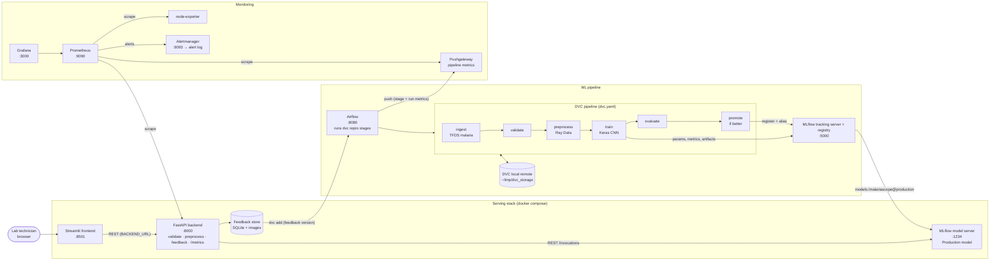

# MalariaScope Architecture (draft, Day 1)

> Draft. Review every block and arrow, change anything you'd design differently, then export the final diagram to `docs/architecture.png` (Day 11).

## Blocks

| Block | Responsibility | Course source |
|---|---|---|
| Streamlit frontend | Upload, show prediction and confidence, collect feedback, Pipeline page | Reference repo `frontend_streamlit/` |
| FastAPI backend | Validates input, preprocesses, calls the model server, stores feedback, exposes `/metrics` | Lecture 10 REST API serving; reference `backend/` |
| MLflow model server | Serves the registered Production model over REST | Lecture 10 MLflow serving; reference `mlflow-model-server/` |
| Feedback store | Keeps user corrections; versioned with DVC for retraining | Reference `backend/main.py` (SQLite); Lecture 2 DVC |
| Airflow | Schedules and runs the pipeline and the feedback retraining | Reference `airflow/dags/` |
| DVC pipeline | Reproducible stages with params and outputs hashed in `dvc.lock` | Lecture 11 DVC for CI |
| Ray Data preprocessing | Parallel validation and resizing, with throughput logged | Lecture 8 Ray |
| MLflow tracking and registry | Runs, metrics, artifacts, model versions and aliases | Lecture 3, Lecture 10 |
| Prometheus, node-exporter, Pushgateway | Collect app, host and pipeline metrics | Lecture 9; reference `monitoring/` |
| Alertmanager + alert receiver | Routes alerts from the Prometheus rules to a local log | Lecture 9 (`sample_rules.yml`, `sample_alertmanager.yml`); Assignment 4 |
| Grafana | Near-real-time dashboards (Service, Pipeline) | Lecture 9; Assignment 4 |

## Open design decisions (yours to make and justify in the HLD)

1. Does the backend call the MLflow model server over REST, as drawn here, or load the model itself like the reference repo does?
2. Feedback storage: SQLite blobs (reference repo) or image files plus a CSV index, which are easier to `dvc add`?
3. How retraining is triggered: a feedback-count threshold (reference: 100), a schedule, a drift signal, or a mix of these.
4. The promotion rule: which metric decides "better", and how a rollback happens.
