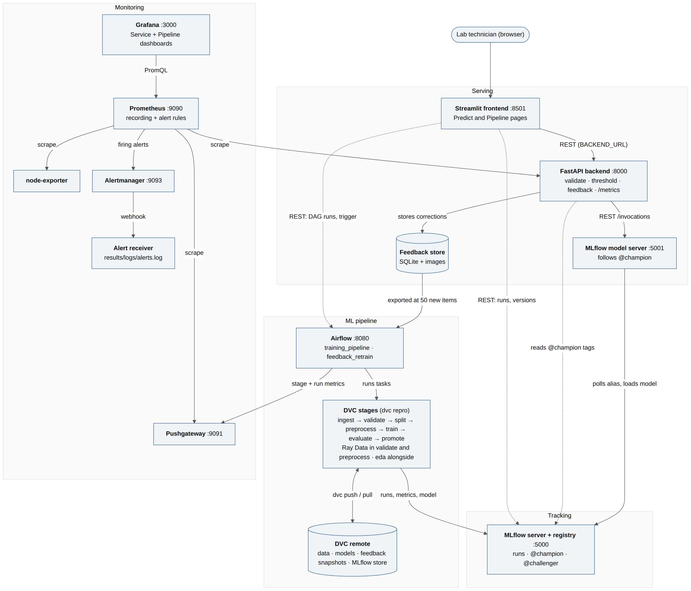

# MalariaScope Architecture

Source: [architecture.mmd](architecture.mmd). Solid arrows are the main data path; dotted arrows are read-only lookups and pipeline controls from the UI. Blocks talk only over REST or files they own, using addresses set in the environment.

## Blocks

| Block | Responsibility | Course source |
|---|---|---|
| Streamlit frontend | Upload, show prediction and confidence, collect feedback, Pipeline page | Reference repo `frontend_streamlit/` |
| FastAPI backend | Validates input, resizes, calls the model server, applies the tuned threshold, stores feedback, exposes `/metrics` | Lecture 10 REST API serving; reference `backend/` |
| MLflow model server | Serves the version behind `@champion` over REST and switches by itself when the alias moves | Lecture 10 MLflow serving; reference `mlflow-model-server/` |
| Feedback store | Keeps user corrections; versioned with DVC for retraining | Reference `backend/main.py` (SQLite); Lecture 2 DVC |
| Airflow | Schedules and runs the pipeline and the feedback retraining | Reference `airflow/dags/` |
| DVC pipeline | Reproducible stages with params and outputs hashed in `dvc.lock` | Lecture 11 DVC for CI |
| Ray Data (validate and preprocess stages) | Parallel image checks and resizing, with throughput logged | Lecture 8 Ray |
| MLflow tracking and registry | Runs, metrics, artifacts, model versions and the `@champion`, `@challenger` and `@previous_champion` aliases | Lecture 3, Lecture 10 |
| Prometheus, node-exporter, Pushgateway | Collect app, host and pipeline metrics | Lecture 9; reference `monitoring/` |
| Alertmanager + alert receiver | Routes alerts from the Prometheus rules to a local log | Lecture 9 (`sample_rules.yml`, `sample_alertmanager.yml`); Assignment 4 |
| Grafana | Near-real-time dashboards (Service, Pipeline) | Lecture 9; Assignment 4 |
