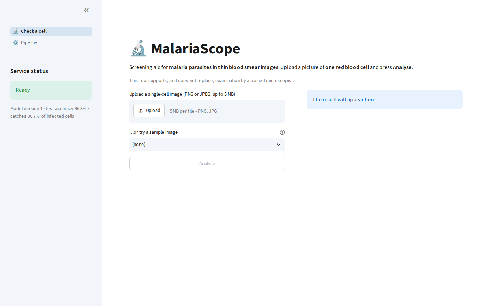
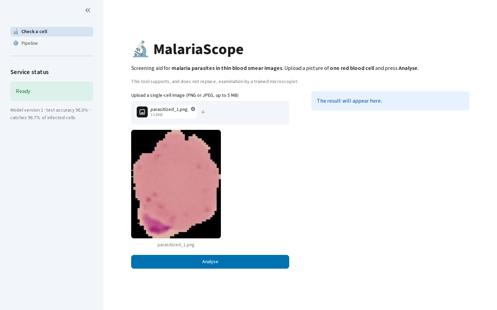
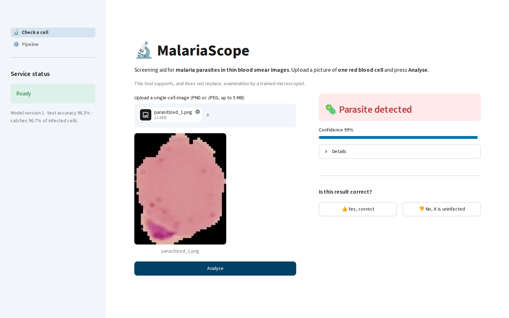
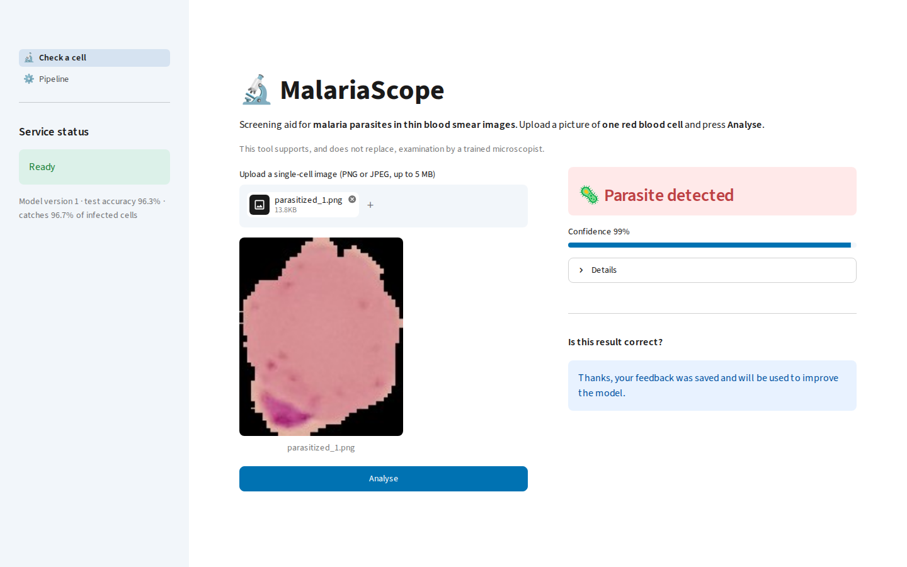

# User Manual: MalariaScope

## 1. Audience

This manual is for laboratory technicians and clinicians who want a quick second opinion on a blood smear cell image. You don't need any programming or machine learning background.

MalariaScope supports a trained microscopist. It doesn't replace one.

## 2. System requirements

- A modern web browser (Chrome, Edge or Firefox).
- Access to the application address given by your IT contact. On the machine running MalariaScope, that is http://localhost:8501.
- A PNG or JPEG picture of **one red blood cell** from a Giemsa-stained thin blood smear, up to 5 MB.

MalariaScope looks at one cell at a time. It can't read a whole slide or a picture with many cells.

## 3. Quick start

1. Open the application address. You will see the MalariaScope page.

   

2. Click **Browse files** and choose your cell image. To try the tool first, pick one under **…or try a sample image**.
3. A preview of the image appears.

   

4. Press **Analyse**. The result appears on the right in about a second.

## 4. Interpreting the result

| What you see | Meaning | Suggested action |
|---|---|---|
| 🦠 **Parasite detected** (red) | The cell is likely infected | Confirm under the microscope and follow your lab's protocol |
| ✅ **No parasite detected** (green) | The cell is likely uninfected | Carry on with your usual screening |
| **Low confidence** warning | The tool isn't sure about this cell | Have a microscopist check it |

The **Confidence** bar shows how sure the tool is about the result it shows. Open **Details** to see the exact probability and the model version.

MalariaScope is set up to catch as many infected cells as it can, so it sometimes flags a healthy cell. In testing on 2,756 cells, it found about 97 of every 100 infected cells and raised a false alarm on about 4 of every 100 healthy cells.

**Note:** this tool is assistive. Always confirm with your lab protocols.

## 5. Providing feedback

Your feedback helps the tool improve.

1. After a result, find **Is this result correct?**
2. Press **👍 Yes, correct** if you agree, or the **👎 No, it is…** button if you don't.
3. A message confirms that your feedback was saved.

   

You can give feedback once per result. The image and your answer are kept to retrain the model. Once 50 new answers have arrived, a new model is trained automatically. It replaces the current one only if it performs better on a fixed set of test images.

Please don't upload images that show patient names or other personal details.

## 6. Common issues and solutions

| Issue | Cause | Fix |
|---|---|---|
| "Analysis service unavailable" in the sidebar | The service is restarting or stopped | Wait about 30 seconds and refresh. If it stays, contact IT |
| "This file is larger than 5 MB" | The image is too big | Export it at a lower resolution, or crop it to one cell |
| "The file is not a readable image" | The file is damaged, or isn't a real PNG or JPEG | Export the image again as PNG or JPEG |
| Your file isn't offered in the file picker | It isn't a PNG or JPEG | Convert it first |
| **Analyse** is greyed out | No image is selected yet | Upload or pick an image |
| "Feedback could not be saved" | The service was interrupted | Try the button again in a few seconds |
| Slow response (over 5 seconds) | The machine is busy, for example during retraining | Wait and try again |

For more detail about the running system, the **Pipeline** page in the left menu shows the current model and links to the technical tools. Most users won't need it.
